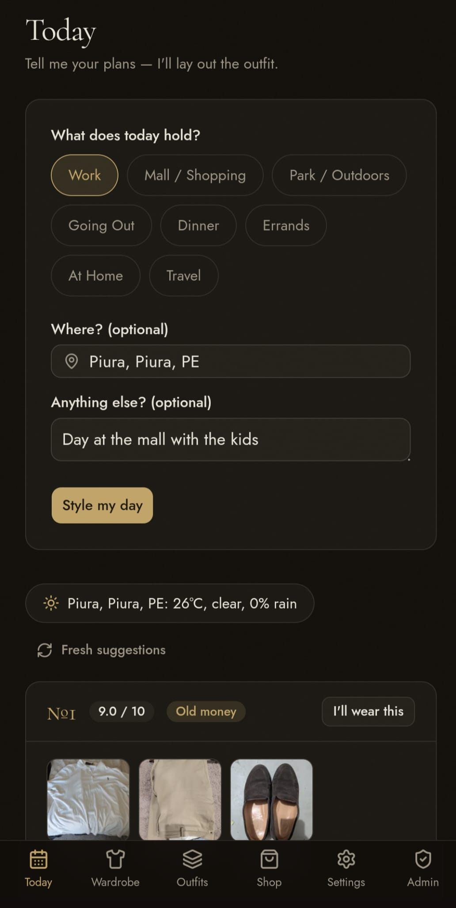
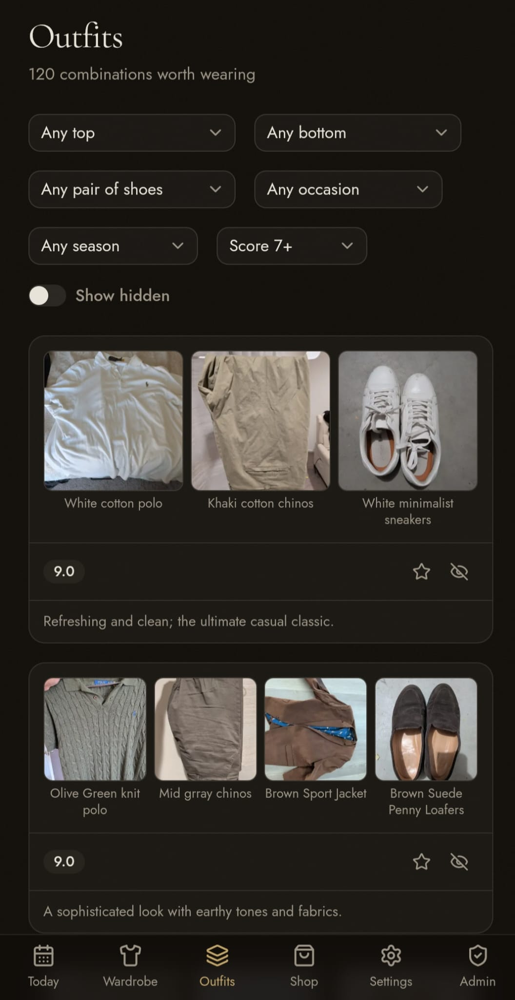
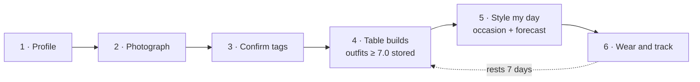
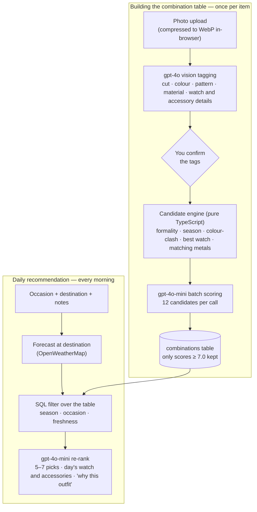
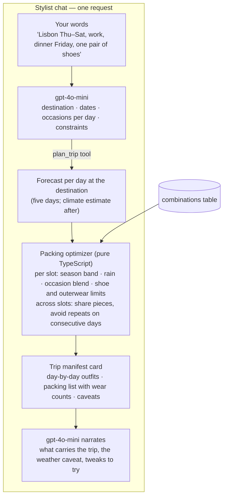
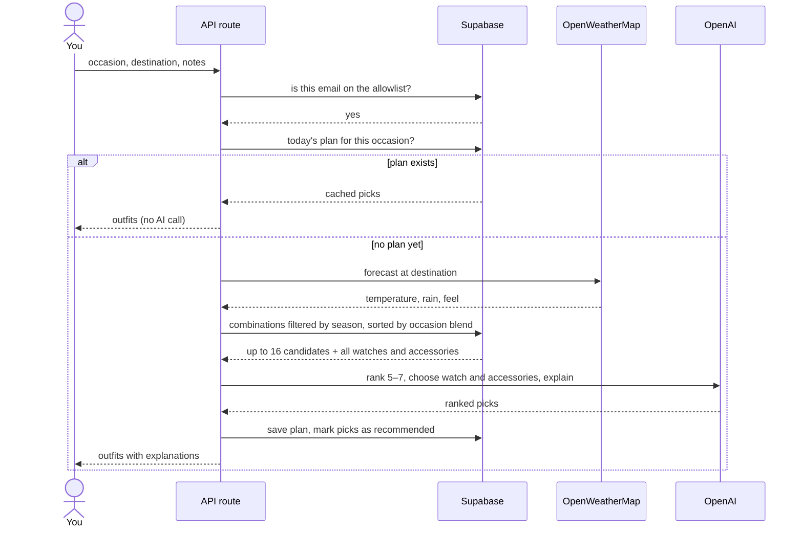
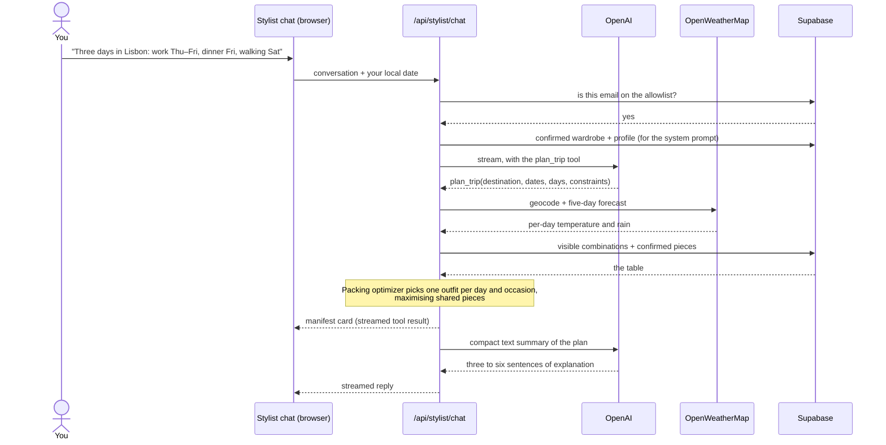
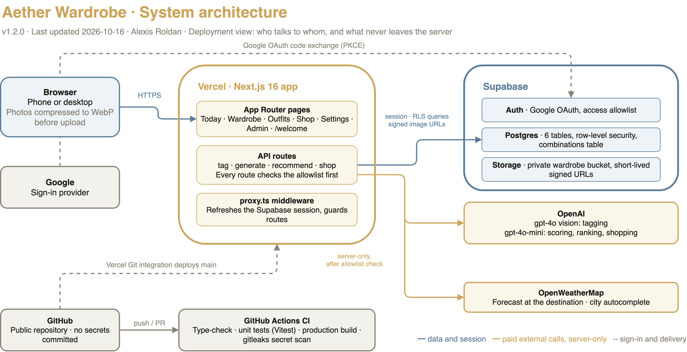
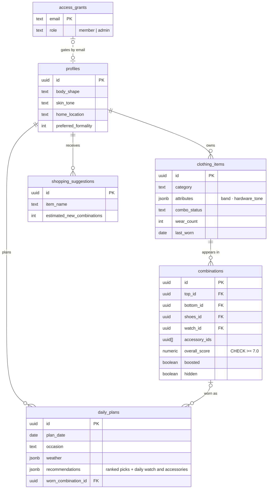

# Aether Wardrobe

**Your personal AI stylist.** Photograph your wardrobe once, tell the app your
plans each morning, and it lays out the outfit: matched to your style, the
occasion, and the weather where you are going.

[](https://github.com/roldanalex/fashion-helper-app/actions/workflows/ci.yml)


> Created by [**Alexis Roldan**](https://github.com/roldanalex) · 2026

**Documentation:** [User guide](docs/USER-GUIDE.md) · [Onboarding site](public/welcome/) (served at `/welcome`) · [Changelog](CHANGELOG.md) · [Architecture diagram](docs/diagrams/architecture.drawio.png)

---

## Contents

1. [Why Aether Wardrobe](#why-aether-wardrobe)
2. [Screenshots](#screenshots)
3. [Features](#features)
4. [Quick start](#quick-start)
5. [How it works](#how-it-works)
6. [Architecture](#architecture)
7. [Project structure](#project-structure)
8. [Configuration](#configuration)
9. [Deployment](#deployment)
10. [Quality and CI](#quality-and-ci)
11. [Security and privacy](#security-and-privacy)
12. [Troubleshooting](#troubleshooting)
13. [Roadmap](#roadmap)
14. [License](#license)

## Why Aether Wardrobe

Most people wear a fifth of what they own. The rest is not wrong, it is
unpaired. Aether Wardrobe treats that as a sorting problem, not a shopping
problem:

- **It only ever suggests clothes you own.** A deterministic engine builds
  every outfit that works from your pieces; the AI scores and explains, it
  never invents.
- **It answers the real morning question.** What fits today's plans, the
  weather at the destination, and what have I not worn recently?
- **It packs the suitcase the same way.** Tell the stylist where you are
  going and what the days hold; it picks one outfit per day from the same
  table, chosen so pieces repeat and the bag stays small.
- **It stays cheap.** The heavy AI work happens once per piece. A daily
  recommendation is a single small model call.

## Screenshots

### Desktop


### Mobile

The app is fully responsive. Catalogue your wardrobe and get your daily outfit
from your phone.

<p>
  
  
</p>

## Features

| Feature | What you get |
| --- | --- |
| **Onboarding wizard** | A four-step profile (build, colouring, style preferences, home city) personalises every AI prompt and provides the weather fallback when you do not name a destination. |
| **Wardrobe cataloguing** | One photo per piece, from your gallery or the phone camera. Photos are compressed to WebP in the browser, then GPT-4o vision reads cut, colour, pattern and material. Your own notes ("pique", "merino") always win over what it sees. |
| **Watches** | Watches are their own category with their own outfit slot. Each is typed by style (dress, sports, diver, GMT, chronograph, field, pilot) and tagged with band and hardware tone. Every outfit gets the best-fitting watch you own, and the daily stylist can swap it for the day. |
| **Accessories** | Belts, bags, scarves, sunglasses, pocket squares and hats. Metal-bearing pieces carry a hardware tone, and the engine matches it to the outfit's watch. |
| **Combination table** | A deterministic engine pairs each confirmed piece against your wardrobe (formality, season and colour-clash filters). gpt-4o-mini scores candidates in batches; only outfits scoring 7.0 or better are kept. |
| **Outfits browser** | Build around a single top, bottom, shoes, outerwear, watch or accessory. Filter by occasion, season or score. Most complete outfits first. Boost favourites, hide misses, see which looks are resting. |
| **Daily recommendations** | Pick one of ten occasions, optionally a destination (city autocomplete) and notes. The app pulls the forecast there, filters the table, and one AI call ranks five to seven picks, chooses the day's watch and accessories, and explains each choice. Temperatures read in °C or °F: flip the unit on the weather line or under Settings, and the whole app follows. |
| **Stylist chat: trip packing** | A conversation with your stylist. "Three days in Lisbon: work Thursday and Friday, dinner Friday, sightseeing Saturday." It reads the forecast for each day, lays out one outfit per day and occasion from your Outfits table, and shows a manifest card: the day-by-day plan, a packing list with how often each piece is worn, and a one-click copy. Ask for tweaks in plain words: one pair of shoes, carry-on only, drop the blazer. Name pieces and they are built in, not hinted at. For a single occasion ("what goes with my navy blazer for dinner on Friday?") it pulls the table's best outfits around those pieces and explains why they work. |
| **Wear tracking** | Mark an outfit as worn and every piece updates its wear count and last-worn date. Recently worn looks rest for a week. |
| **Shopping gap analysis** | Tick the categories you are shopping for. The app counts how many new outfits one good piece would unlock and suggests specific items that pair with what you own. |
| **Live status and readiness** | A banner tracks outfit generation in the background. If a batch is interrupted, one click rebuilds only what is missing. |
| **Admin allowlist** | Grant or revoke access by email from the in-app `/admin` page. |
| **Onboarding site** | A self-contained "why and how" page at `/welcome` with a value deck, a step-by-step guide with checkpoints, light and dark themes, and print-to-PDF. |

## Quick start

### Prerequisites

- **Node.js 20+** and **pnpm**
- Free-tier accounts for four services:

| Service | Used for | Where |
| --- | --- | --- |
| Supabase | Database, Google sign-in, image storage | [supabase.com](https://supabase.com) |
| Google Cloud | OAuth credentials for sign-in | [console.cloud.google.com](https://console.cloud.google.com/apis/credentials) |
| OpenAI | Vision tagging, outfit scoring and the stylist chat | [platform.openai.com](https://platform.openai.com) |
| OpenWeatherMap | Destination weather and city autocomplete | [openweathermap.org/api](https://openweathermap.org/api) |

### 1. Set up Supabase

1. Create a project, then run every file in `supabase/migrations/` **in
   order** in the SQL Editor (or `supabase link && supabase db push` with the
   CLI). The editor warns that `0008` and `0009` contain `DROP` statements;
   they only rebuild an index and a check constraint, and remove no data.
2. The private `wardrobe` storage bucket is created by migration `0006`.
3. **Grant yourself access.** The app is invitation-only, so bootstrap the
   first admin in the SQL Editor:

   ```sql
   insert into public.access_grants (email, role)
   values ('you@example.com', 'admin');
   ```

   Without this step every sign-in, including yours, lands on the "awaiting
   invitation" screen.

**Upgrading?** From 1.0.x, run `0008_accessories.sql` then
`0009_watches.sql`. From 1.1.x, run `0009_watches.sql` only: it moves your
existing watches from Accessories into the new Watches category and into the
new watch slot of every outfit that had one.

### 2. Enable Google sign-in

1. In Google Cloud Console, create an **OAuth client ID** (Web application).
2. Set the authorised redirect URI to
   `https://<your-project>.supabase.co/auth/v1/callback`.
3. Paste the client ID and secret into **Supabase → Auth → Providers → Google**.
4. For local development, add `http://localhost:3000/auth/callback` under
   **Supabase → Auth → URL Configuration → Redirect URLs**.

### 3. Configure and run

```bash
cp .env.example .env.local   # fill in your keys
pnpm install
pnpm dev
```

Open <http://localhost:3000>. The expected first run:

1. Sign in with Google and complete the profile wizard.
2. Add a top, a bottom and a pair of shoes; confirm each one's tags.
3. Wait for the generation banner to finish, then open **Today** and tap
   **Style my day**.
4. Open **Stylist** and describe a trip to get a packing plan.

## How it works

Six steps. The first three happen once per piece, the last three every day.



The **combination table is the single source of truth**. The AI never
invents outfits at recommendation time. It tags pieces, scores candidate
combinations the engine already vetted, and ranks and explains rows that
already exist.



### Packing for a trip

The Stylist tab is a chat, but the outfits still come from the table. The
model's only job is to turn your words into a structured request for the
planner, and then to explain what the planner chose.



### Request flow for "Style my day"



### Request flow for a packing plan



## Architecture



Source: [`docs/diagrams/architecture.drawio`](docs/diagrams/architecture.drawio)
(open in [draw.io](https://app.diagrams.net)).

### Engineering decisions

- **Deterministic first, one small AI call last.** The candidate engine in
  `src/lib/combinations/candidates.ts` generates and filters pairings in pure
  TypeScript. The LLM only scores, ranks and explains. Results stay
  consistent and costs stay flat.
- **The chat follows the same rule.** The stylist chat cannot compose an
  outfit. Its two tools run over the table: `plan_trip` calls the packing
  optimizer in `src/lib/trips/pack.ts`, and `find_outfits` returns scored
  outfits containing the pieces you named. The model only translates your
  words into tool inputs and narrates the result. Earlier plans in
  the conversation are replayed to the model as short text summaries, not
  full payloads, so a long chat stays cheap.
- **Batch scoring for cost control.** Candidates are scored 12 per
  gpt-4o-mini call and only outfits scoring 7.0 or better are stored,
  enforced by a database `CHECK` constraint. Estimated cost: about one to
  three cents per uploaded item, fractions of a cent per daily request.
- **Spend where it matters.** The Stylist chat runs on gpt-5.5 (low
  reasoning effort) because its job, turning your words into exact tool
  inputs and carrying every constraint through a conversation, is where
  a small model fails. A message costs a few cents; the high-volume batch
  scoring stays on gpt-4o-mini.
- **No paid call without approval.** Every API route verifies the caller
  against the `access_grants` allowlist before touching OpenAI or
  OpenWeatherMap.
- **Defence in depth.** Row-level security on every table, a private storage
  bucket with short-lived signed URLs, and `server-only` imports that make it
  a build error for API keys to reach the browser.
- **Next.js 16 idioms.** App Router route groups, per-route `loading.tsx`,
  session refresh in the `src/proxy.ts` middleware, and structured AI output
  via the Vercel AI SDK's `generateObject` with Zod schemas.

### Data model

Six tables, all behind Supabase row-level security. Watch and accessory
details live in a `jsonb` column on `clothing_items`. A combination has three
required slots (top, bottom, shoes) and three optional ones (outerwear, watch,
accessories). The uniqueness rule covers all six, so one base outfit may exist
once per watch or accessory variant.



## Project structure

```text
src/
├── app/
│   ├── page.tsx            # Landing page with React Three Fiber hero
│   ├── onboarding/         # 4-step profile wizard
│   ├── auth/callback/      # OAuth PKCE code exchange
│   ├── (app)/              # Auth-gated: today, stylist, wardrobe, combinations, shop, settings, admin
│   └── api/                # 8 routes; every one checks the allowlist before spending
├── components/             # shadcn/ui primitives + feature components
├── lib/
│   ├── ai/                 # 5 AI call sites (tagging, scoring, re-ranking, shopping, stylist chat) + helpers
│   ├── combinations/       # Deterministic candidate engine, generation, readiness
│   ├── trips/              # Packing optimizer, trip planner, tool schema, calendar helpers
│   ├── supabase/           # Browser / server / middleware clients
│   └── …                   # weather, geocoding, image compression, access control, gap analysis
├── test/                   # Shared test fixtures
├── proxy.ts                # Next 16 middleware: Supabase session refresh
└── stores/                 # Zustand (onboarding draft)
public/welcome/             # Static onboarding site (index.html + aether_onboarding.json)
docs/                       # User guide, screenshots, architecture diagram
supabase/migrations/        # 9 SQL migrations: schema, RLS, storage, access control, accessories, watches
.github/workflows/ci.yml    # Type-check, tests, build, secret scan
```

Unit tests live next to the code they cover as `*.test.ts`.

## Configuration

| Variable | Exposed to browser? | Used for |
| --- | --- | --- |
| `NEXT_PUBLIC_SUPABASE_URL` | Yes (safe by design) | Supabase client |
| `NEXT_PUBLIC_SUPABASE_ANON_KEY` | Yes (safe by design; RLS enforces access) | Supabase client |
| `OPENAI_API_KEY` | **Server-only** | Vision tagging, scoring, re-ranking, shopping suggestions, stylist chat |
| `OPENWEATHER_API_KEY` | **Server-only** | Forecasts (today, and day by day for trips) and city autocomplete |
| `STYLIST_MODEL` | **Server-only**, optional | OpenAI model for the Stylist chat. Default `gpt-5.5`; set `gpt-5.4-mini` to trade some reliability for cost |

Tuning knobs live in `src/lib/constants.ts`: scoring batch size, minimum
stored score, candidate cap, number of daily picks, freshness window, the
weight each occasion gives to work, daily, formality and old-money scores,
and the packing optimizer's penalties (new piece, travel-light, repeated
outfit), trip length cap and chat history limit.

> **Tip:** set a monthly budget cap on your OpenAI key. The app is designed to
> stay cheap, but a cap costs nothing and removes all surprise.

## Deployment

1. Push to GitHub and import the repository at
   [vercel.com/new](https://vercel.com/new).
2. Add the four environment variables from `.env.example`.
3. In **Supabase → Auth → URL Configuration**, set the Site URL to your Vercel
   domain and add `https://<your-domain>/auth/callback` to the redirect list.

> **Note:** the outfit-generation routes declare `maxDuration = 300` seconds.
> Vercel's Hobby tier caps function duration lower by default, so large
> wardrobes may need a Pro plan, or the built-in rebuild button to resume an
> interrupted batch.

## Quality and CI

Every push and pull request runs [the CI workflow](.github/workflows/ci.yml):

| Job | What it checks |
| --- | --- |
| Type-check | `tsc --noEmit` over the whole project |
| Unit tests | Vitest over the deterministic core: candidate engine, watch and accessory picking, readiness, gap analysis, packing optimizer, calendar helpers, occasion weights, Zod schemas, prompt descriptors |
| Production build | `next build` with no secrets; every external call happens at request time |
| Secret scan | [gitleaks](https://github.com/gitleaks/gitleaks) over the full git history |

Run the same checks locally:

```bash
pnpm typecheck
pnpm test          # or pnpm test:watch
pnpm build
```

The AI call sites are deliberately not unit-tested; they are thin wrappers
around `generateObject` whose output is validated by the same Zod schemas the
tests cover.

## Security and privacy

- **No secrets in this repository.** All credentials live in environment
  variables. `.env*` files are git-ignored; only the placeholder
  `.env.example` is tracked, and CI scans every commit with gitleaks.
- **Invitation-only usage.** Anyone can sign in with Google, but only emails
  on the `access_grants` allowlist can use the app. Every AI endpoint verifies
  approval server-side before spending API credits.
- **Row-level security** on every table: users only ever read or write their
  own rows.
- **Private photos.** Wardrobe images live in a private bucket served through
  short-lived signed URLs. Storage policies scope every operation to the
  owner's folder. Images go to the vision model only for tagging, never for
  scoring or ranking.
- **Server-only keys.** Weather and OpenAI calls run server-side only;
  `server-only` imports make the build fail if a key could reach the browser.

## Troubleshooting

| Symptom | Cause and fix |
| --- | --- |
| Sign-in lands on "awaiting invitation" | Your email is not in `access_grants`. Insert it with the SQL in [Quick start](#1-set-up-supabase). |
| Saving tags fails after upgrading | A migration has not been run. Run `0008` and `0009` in the SQL Editor, in order. |
| Saving a watch fails with a category error | Migration `0009` has not been run; it allows the `watch` category. |
| A watch shows the wrong style after upgrading | `0009` sets the type from the old watch-style chip, or *sports* when none was set. Open the watch, pick the right style, **Save changes**. |
| Images do not show in the wardrobe grid | Migration `0006` (storage) was not run, or the bucket was created by hand with a different name. |
| The stylist says it cannot place a destination | Give the city and country ("Porto, Portugal"); the geocoder takes the first match. |
| A trip day shows "no forecast" | The free forecast reaches five days ahead. Tell the stylist the expected temperature, or let it estimate from the season. |
| "No outfits yet" with pieces confirmed | Generation was interrupted. Use **Rebuild outfits** on the Wardrobe tab. |
| Outfit generation times out on Vercel | Hobby tier function limit. Upgrade the plan or use the rebuild button, which resumes where it stopped. |
| Local Google sign-in bounces to the landing page | Add `http://localhost:3000/auth/callback` to Supabase's redirect URLs. |

## Roadmap

Built solo and used daily. Honest notes on what is not here yet:

- **Integration tests** against a Supabase branch; today the suite covers the
  deterministic core only.
- **Single-photo items.** One photo per piece; multi-angle photos are a
  candidate feature.
- **Saved trips.** A packing plan lives in the conversation on your device;
  saving named trips to the database, and ticking pieces off while packing,
  is the natural next step.
- **Ideas on the list:** laundry and availability tracking, seasonal
  rotation reminders, more accessory types (ties, cufflinks, bracelets) on
  the same `attributes` mechanism.

## License

Released under the [MIT License](LICENSE) · © 2026
[**Alexis Roldan**](https://github.com/roldanalex).
